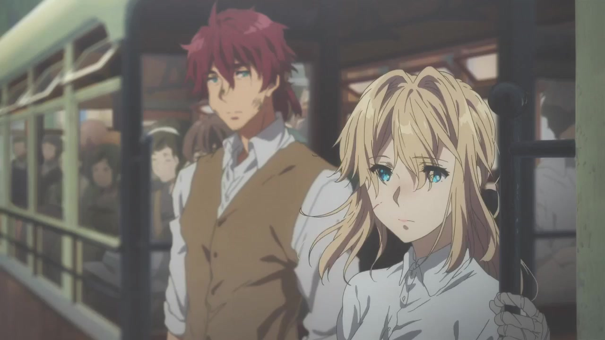
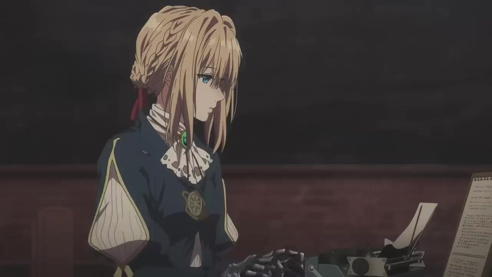
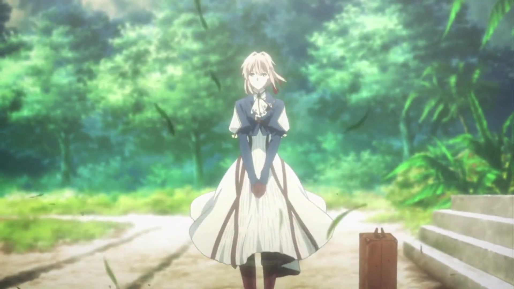
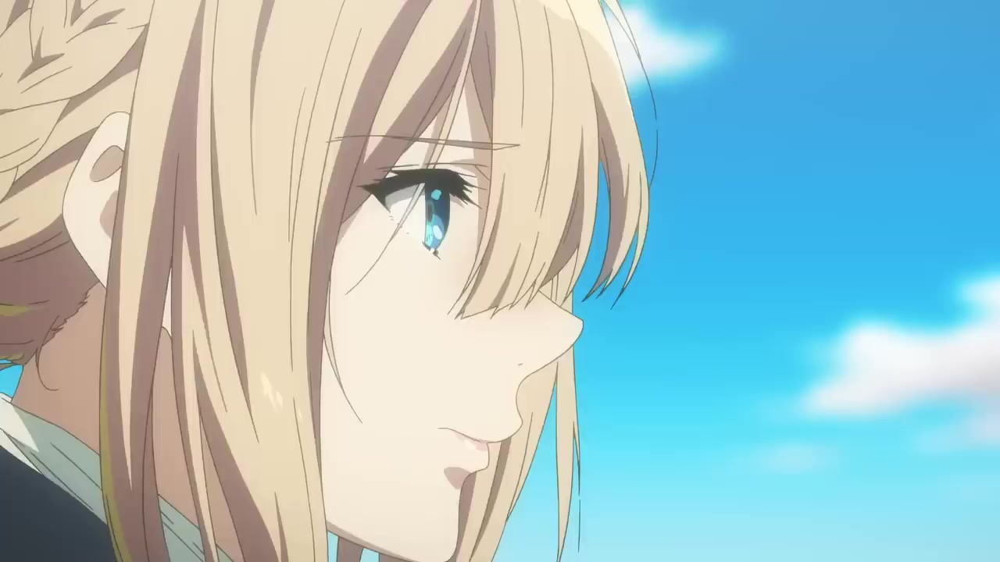

# *Violet Evergarden* and utopia
After the end of a great war, the titular character of *Violet Evergarden* (2018) steps into everyday civilian society, a culture her upbringing as a child soldier did not entirely prepare her for.

To learn about the intricacies of the human condition, she takes on the position of a letter ghostwriter, writing for people not literate enough to express themselves so. Viewers follow Violet Evergarden as she helps her customers, and in the process comes to better understand others and herself.

While not presented as such, *Violet Evergarden* is well interpreted as a depiction of a utopian world.

On a superficial reading, it's the opposite. Many of Violet's customers are dying or have lost loved ones, while Violet herself is pulled down by the weight of her past actions. *Violet Evergarden* is centrally a story of grief, and derives its deep emotional impact from the empathizable misfortunes of its characters.

Nevertheless, *Violet Evergarden* is also centrally a story of processing and overcoming grief. Not coincidentally, none of the misfortunes portrayed are, ultimately, truly horrible. There is armed conflict and deaths of soldiers, but the deaths shown on the battleground are swift, and there are no prisoners of war in inhumane conditions nor civilian destruction in sight. There is deadly illness, but no unbearable agony. There are grieving family members, but none who are so crushed as to not carry on.

Throughout, the world is a place where people can undergo healthy grieving and processing of loss. All of the characters are, in their own ways, well-intentioned and broadly enjoying life, and none are so lonely as to not be surrounded and supported by such people. And they don't have struggles beyond the psychological and interpersonal – in particular, they are not at risk of poverty or famine, despite the implied technological level of their society.

And most importantly of all, the world is a place where the profession of letter ghostwriters exists.

>"It is a pleasure to meet you. If it is your wish, I will travel anywhere to meet your request. Auto Memory Doll, Violet Evergarden, at your service."

Violet often goes on long journeys, spending hours or days traveling and staying by the side of her customer, only to produce a single letter. This is not only economically suboptimal, it's outright infeasible! A postal service could not operate in such a manner, and would quickly be outcompeted by a more cost-effective organization.

But the story was written in this way for good reason: it would be beautiful for the profession of Auto Memory Dolls to exist, and for Dolls to not be short of time. The story is designed to conform to human values, and so its economics give room for them to blossom. Reality, [bitterly](/me_olli), does not.

It's nigh-impossible to imagine how reality could be otherwise. Famine, material scarcity, even illness and death are all issues we can and should overcome. But how could you overturn something as fundamental as economics, something as basic as selection effects? It'd take magic to have reality *not* be dictated by competitive races to the bottom and never-ending king-of-the-hill battles, eroding human values away in the process.

Then again, sufficiently advanced technology is indistinguishable from magic. So, hopefully, like in *Violet Evergarden*, we will grieve the state of affairs, but it will all turn out well in the end.

